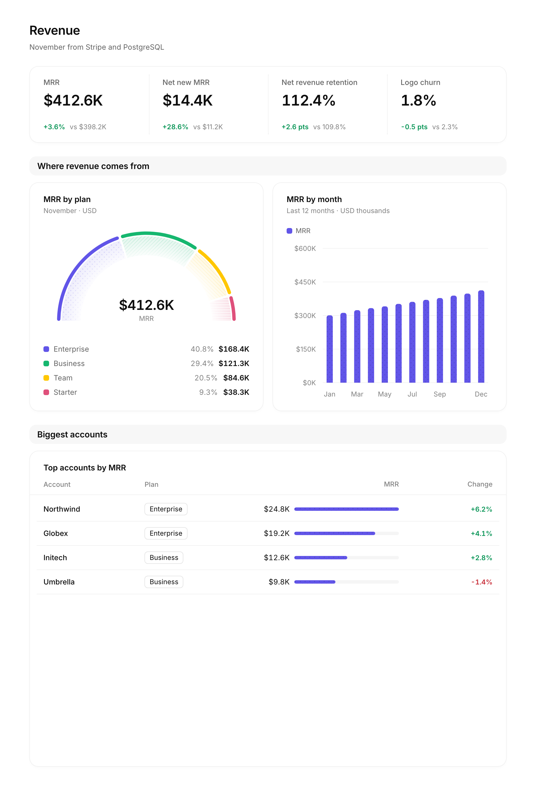
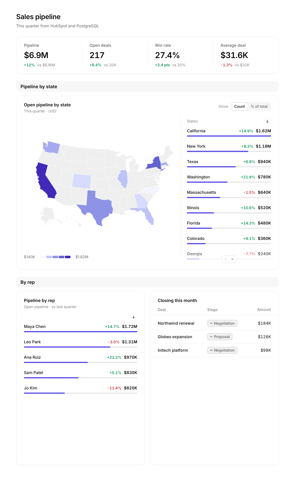
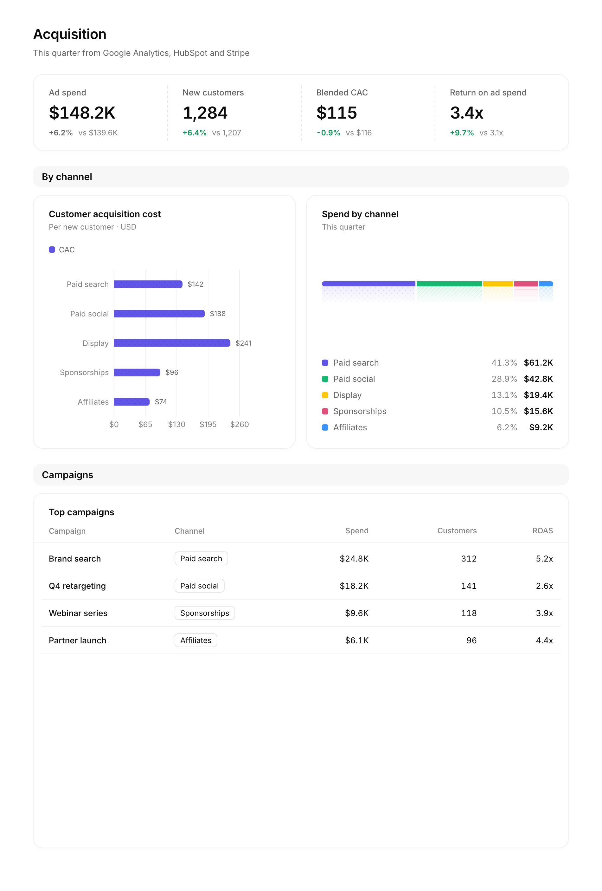
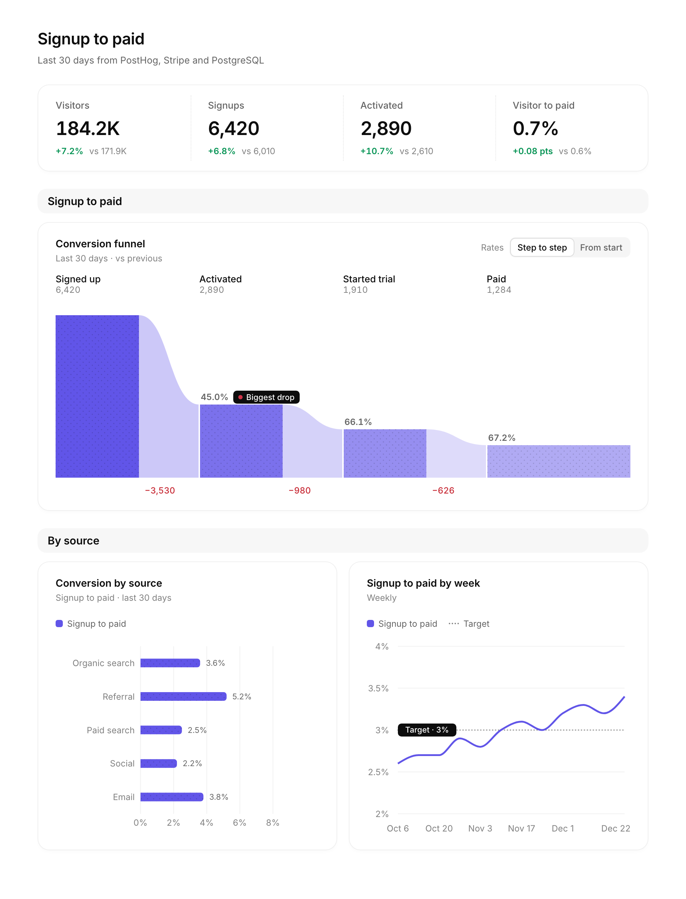
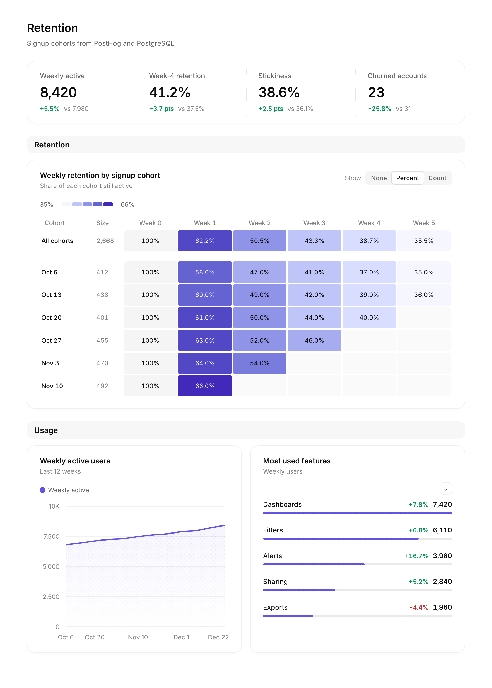

<p align="center">
  
</p>

<h1 align="center">OpenDashboards</h1>

<p align="center"><strong>Ask any question. Get a live dashboard.</strong><br />The open-source alternative to Claude Dashboards.</p>

<p align="center">
  <a href="https://opendashboards.com">Website</a> ·
  <a href="https://opendashboards.com/apps">Sign up</a> ·
  <a href="https://discord.com/invite/Pbv5PsqUSv">Discord</a> ·
  <a href="https://x.com/openuidev">X</a>
</p>

<p align="center">
  <a href="LICENSE"></a>
  <a href="https://github.com/thesysdev/opendashboards/stargazers"></a>
</p>

## What is OpenDashboards

Connect your databases and tools, ask a question in plain words, and get a live, interactive
dashboard that pulls from all of them. Filter it, drill down, and edit one chart without
touching the rest.

OpenDashboards is open source (MIT). It builds dashboards with the OpenUI Dashboards API, so you
can use any model and host it anywhere: at [opendashboards.com](https://opendashboards.com), or
on your own servers.

## Product tour

One question, one dashboard, from every tool that has part of the answer.

<table>
  <tr>
    <td width="50%"><br /><b>"How was revenue this month?"</b><br />MRR, net new revenue and churn, from Stripe and Postgres.</td>
    <td width="50%"><br /><b>"How are my sales looking?"</b><br />Pipeline by stage and rep, from HubSpot and Postgres.</td>
  </tr>
  <tr>
    <td width="50%"><br /><b>"Which ads are actually working?"</b><br />Cost per customer by channel, from Google Analytics, HubSpot and Stripe.</td>
    <td width="50%"><br /><b>"Are signups turning into customers?"</b><br />The signup-to-paid funnel by source, from PostHog, Stripe and Postgres.</td>
  </tr>
  <tr>
    <td width="50%"><br /><b>"Are customers sticking around?"</b><br />Weekly retention by cohort, from PostHog and Postgres.</td>
    <td width="50%"></td>
  </tr>
</table>

## Why OpenDashboards

- 🔒 **Your data, your servers.** Connection credentials stay on your server, and queries run
  from it. For complete isolation, OpenUI Cloud can be privately hosted inside your network.
- 🧠 **Any model.** Use any model the OpenUI Dashboards API supports, or bring your own OpenAI
  or Anthropic key.
- 📊 **Live and interactive.** Dashboards stay connected to your data. Filter them and drill
  down, and they update when the data does.
- ✏️ **Edit one chart.** Ask for a change and only that chart is built again.
- 🧩 **Open source.** MIT licensed. Read it, fork it, run it.

## Data sources

| Source | Status | What you need |
| --- | --- | --- |
| PostgreSQL (and Supabase, Neon) | ✅ Supported | Host, database and a read-only user, or a connection string |
| MySQL / MariaDB | ✅ Supported | Host, database and a read-only user, or a connection string |
| ClickHouse | ✅ Supported | HTTPS host, database and a read-only user |
| BigQuery | ✅ Supported | Project ID and a service account key |
| PostHog | ✅ Supported | Region, project ID and a personal API key |
| Google Analytics (GA4) | ✅ Supported | Property ID and a service account key |
| Search Console | ✅ Supported | Property and a service account key |
| Any MCP server | ✅ Supported | A remote (HTTPS) server URL, and its API key if it needs one |

Queries are read-only. Anything without a built-in connector, like Stripe or HubSpot, connects
through its MCP server.

## Quick start

### ☁️ Use the hosted version

Sign up at [opendashboards.com](https://opendashboards.com). Nothing to install.

### 🧑‍💻 Run it yourself

You need Node 20.9 or later, pnpm and Docker, and a Thesys API key from
[console.thesys.dev](https://console.thesys.dev). OpenUI Cloud has a generous free tier.

```bash
git clone https://github.com/thesysdev/opendashboards.git
cd opendashboards
pnpm install
cp .env.example .env.local   # then add THESYS_API_KEY
pnpm db:up                   # Postgres on localhost:54329 (plus an opendashboards_test database)
pnpm db:reset                # create the tables from lib/db/schema.ts
pnpm dev                     # http://localhost:3000
```

Locally, every request acts as the dev user in `config/local.ts`, and connection keys are
stored unencrypted. Production refuses both.

### 🚀 Deploy to production

Fork the repo, implement your auth, and deploy. Auth is one interface, `AuthProvider` in
`lib/auth/provider.ts`: add yours to `lib/auth/providers/` and pick it in `lib/auth/index.ts`.

## How it works

1. **Connect** your databases and tools. Credentials are encrypted and stay on your server.
2. **Ask** a question. The Build agent explores your sources and plans the dashboard.
3. **Get a dashboard.** The OpenUI Dashboards API builds it, and it queries your sources live
   through your server every time it opens.
4. **Refine** it by chatting. Change one chart, add a filter, or start a new dashboard in the
   same app.

The data behind each answer goes to the OpenUI Dashboards API, which runs on OpenUI Cloud and
stores your dashboards and chats. Configure the API, models and BYOK at
[console.thesys.dev](https://console.thesys.dev).

## Development

### Tests

```bash
pnpm test
```

The service tests run against the `opendashboards_test` database from `pnpm db:up`.

### Settings

Settings (URLs, the model, timeouts, the local dev user) live in `config/`: `common.ts`, plus
`local.ts` or `prod.ts`. `.env.local` is only for secrets, and the server refuses to start
without one it needs.

### How it fits together

| Area | Where |
| --- | --- |
| Landing page (public, at `/`) | `app/(marketing)/`, `components/landing/` |
| Signed-in app: apps, dashboards, connections | `app/(app)/`, `components/` |
| Auth providers and the public paths | `lib/auth/`, `proxy.ts` |
| Build agent and its tools | `lib/agent/`, `lib/tools/`, `app/api/apps/[appId]/chat/` |
| Dashboards on OpenUI Cloud | `lib/dashboards/`, `app/api/interpreter/` |
| Data sources, one folder per connector | `lib/sources/` |
| Connection service (validation, ownership, statuses) | `lib/connections/` |
| Secret storage (`SecretBox`: `plaintext` locally, `kms` in production) | `lib/secrets/` |
| Apps, connection usage, chat threads | `lib/apps/`, `app/api/apps/[appId]/threads/` |
| Schema and migrations | `lib/db/schema.ts`, `db/migrations/` |

### Schema changes

Edit `lib/db/schema.ts`, run `pnpm db:generate` to write the migration, then `pnpm db:reset`
to rebuild your local database from the migrations (it drops all data and refuses non-local
databases). The test suite resets `opendashboards_test` the same way before it runs.

Run `pnpm db:migrate` before each deploy. A migration runs while the previous deployment is
still serving. Keep migrations additive, and remove old columns in a
later release.

## License

[MIT](LICENSE) © Thesys Inc.
